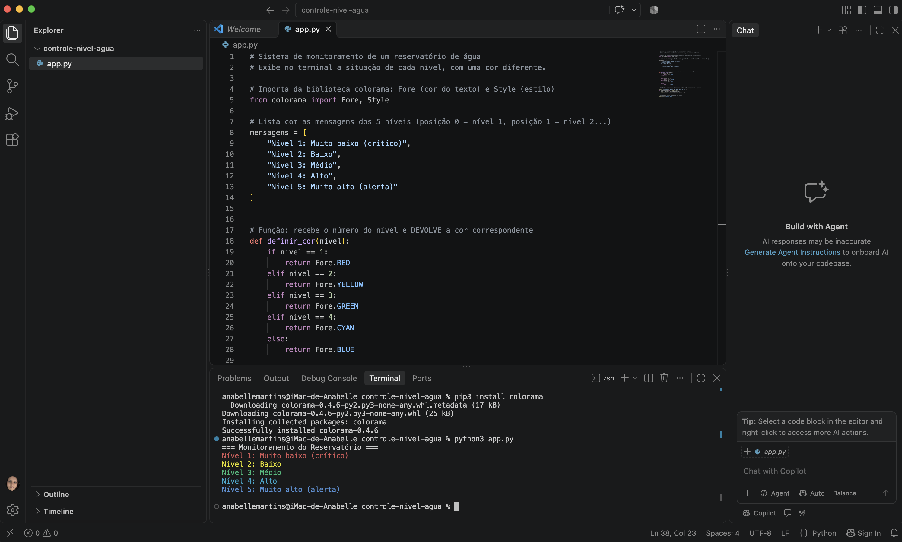

# 💧 Controle de Níveis de Água


## 📌 Sobre o projeto

Programa em Python que simula o monitoramento de um reservatório de
água. O sistema exibe no terminal a situação de cada um dos cinco
níveis do reservatório, com uma cor diferente para cada situação,
facilitando a visualização do risco.

## 🐍 Linguagem e biblioteca

- Python 3
- Biblioteca externa **colorama** (cores no terminal)

## 🎨 Níveis e cores

| Nível   | Situação                | Cor      |
|---------|-------------------------|----------|
| Nível 1 | Muito baixo (crítico)   | Vermelho |
| Nível 2 | Baixo                   | Amarelo  |
| Nível 3 | Médio                   | Verde    |
| Nível 4 | Alto                    | Ciano    |
| Nível 5 | Muito alto (alerta)     | Azul     |

## ⚙️ Como funciona

- Uma **lista** guarda as mensagens dos 5 níveis.
- A **função** `definir_cor(nivel)` recebe o número do nível e
  devolve a cor correspondente (`return`).
- Um laço `for` percorre os níveis e exibe cada mensagem com sua cor.
- Ao final, `Style.RESET_ALL` restaura o estilo padrão do terminal.

## ▶️ Como executar

1. Instale a biblioteca no terminal:

```
pip3 install colorama
```

2. Execute o programa:

```
python3 app.py
```

## 📸 Execução do programa



## 🎓 Atividade

Projeto desenvolvido para a disciplina de Desenvolvimento de Sistemas I —
Agenda 11: Bibliotecas.